# De la demande de la direction au rapport : le parcours en images

[Commencer le cours](../README.md) · [Livret 00 — Lire-moi](../pdf/00_lire_moi.pdf) · [Livret 01 — Démarrer](../pdf/01_demarrer.pdf)

## A — Comprendre la mission

Vous rejoignez Solen Digital. Son client Maison Zitouna veut savoir où passe la marge. Chaque étape du cours se justifie par la précédente : une question métier, des données, un indicateur défini précisément, une décision.

## B — Qui fait quoi : Codex, vous, votre binôme

Codex écrit le code. Vous lisez le diff et lancez les contrôles. Votre binôme relit. L'équipe livre. Aucun code n'entre dans `main` sans ces trois regards.

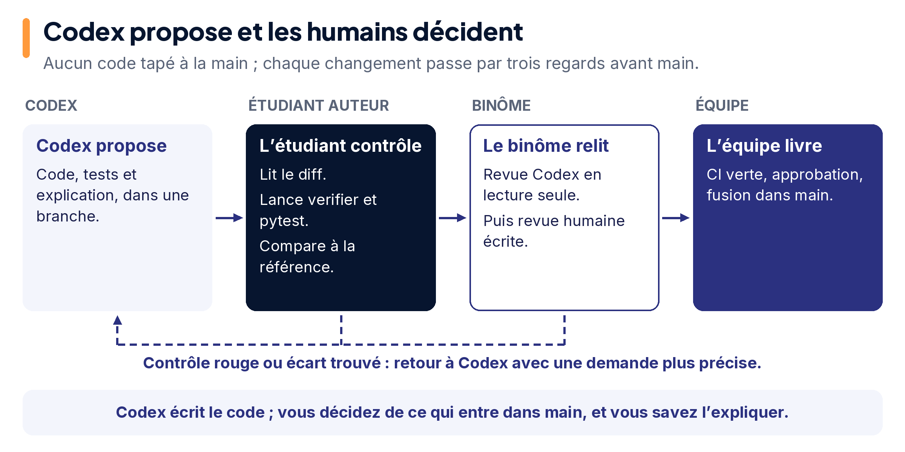

Modèle, effort, vitesse, tokens, contexte et quota sont six choses différentes. Le cours n'utilise que les réglages visibles sur un compte Free.

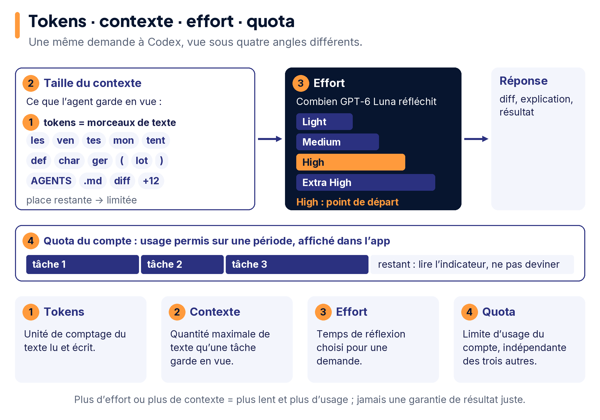

## C — Installer : Windows avec WSL2, ou Ubuntu

Sous Windows, l'application ChatGPT reste une fenêtre Windows ; l'agent Codex, Python et Git travaillent dans Ubuntu WSL2 ; Power BI Desktop reste sur Windows. Sous Ubuntu natif, tout se fait dans Ubuntu sauf Power BI, sur un poste Windows de la salle ou du binôme.

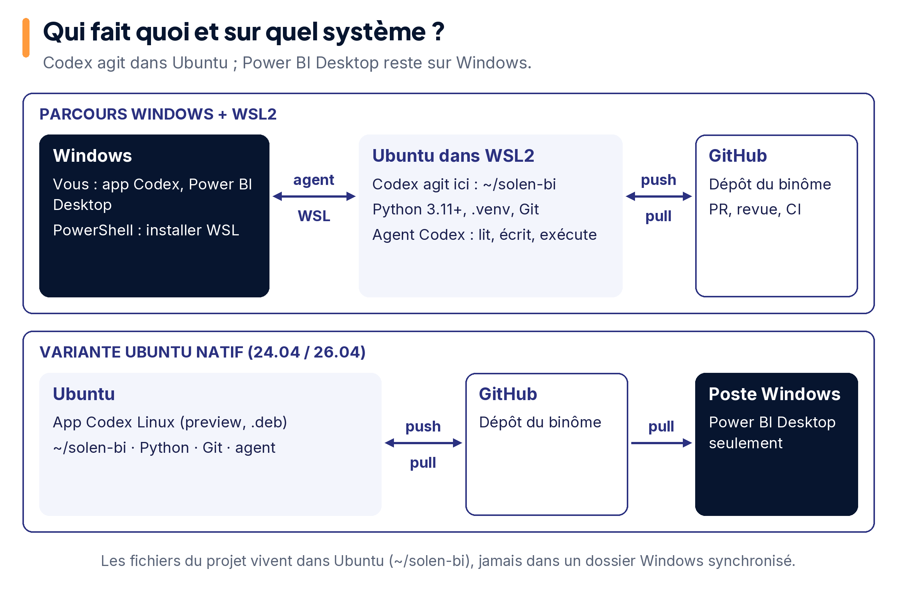

## D — Travailler à deux avec Git et GitHub

Deux copies locales, une copie partagée sur GitHub. Les fichiers ne se synchronisent pas tout seuls : commit, push, pull, pull request.

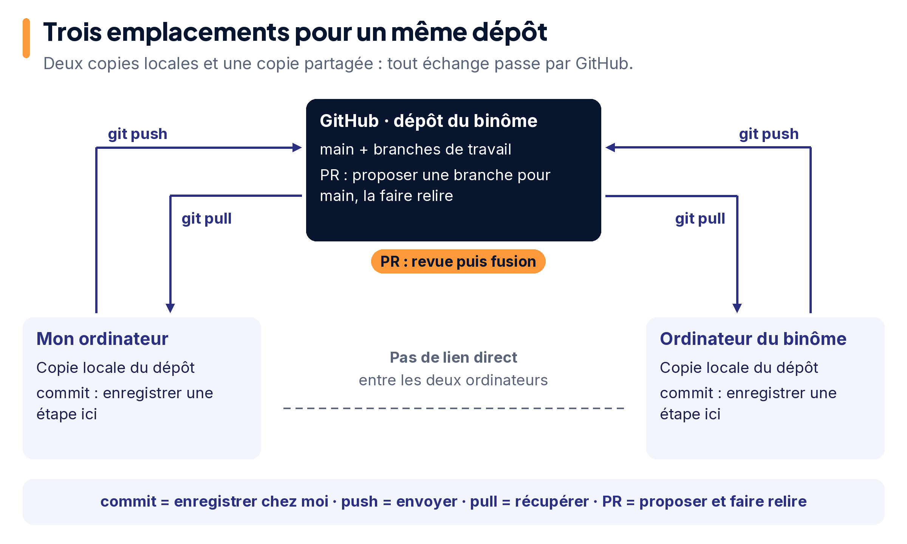

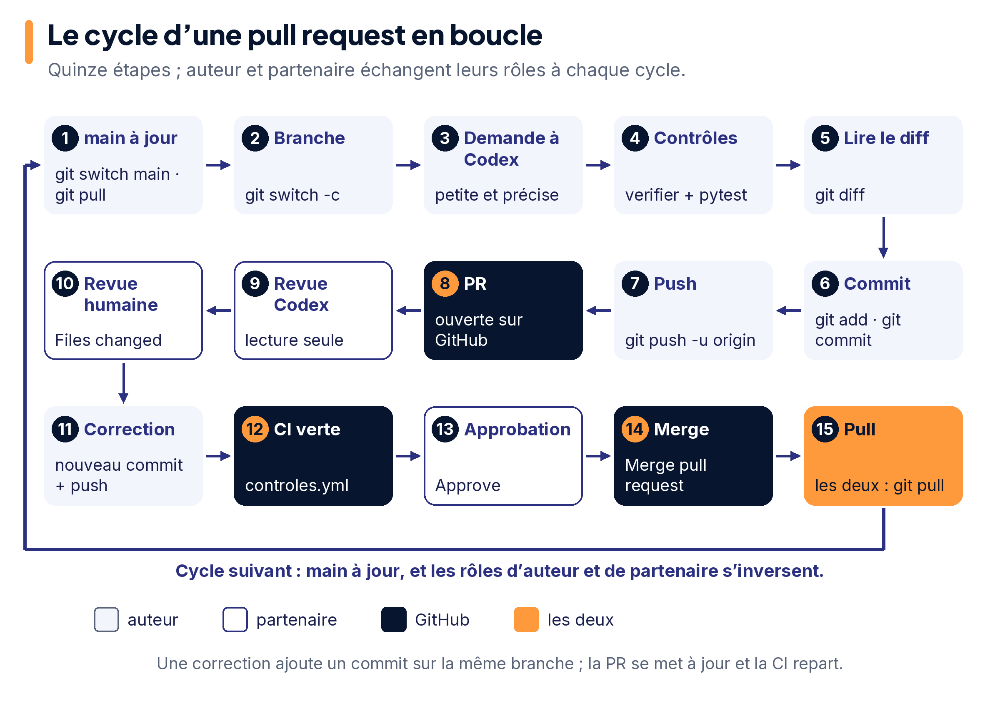

## E — Des quatre sources à l'entrepôt

CSV, Excel, JSON et une base SQLite opérationnelle entrent ; l'ETL écrit par Codex nettoie, harmonise, dédoublonne, charge les dimensions puis les faits ; les rejets vont dans `rejets.csv` avec leur motif.

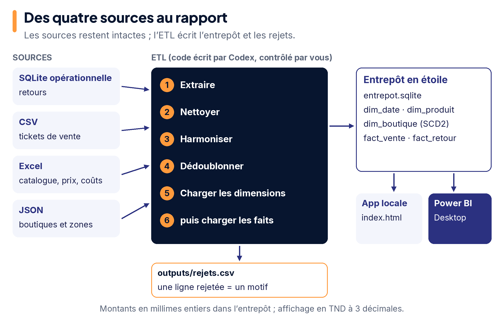

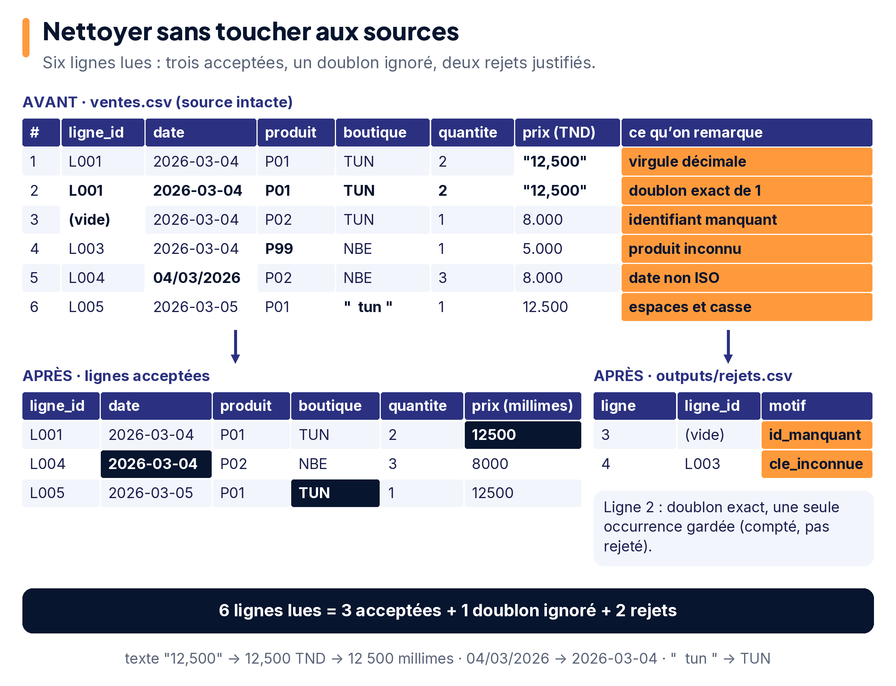

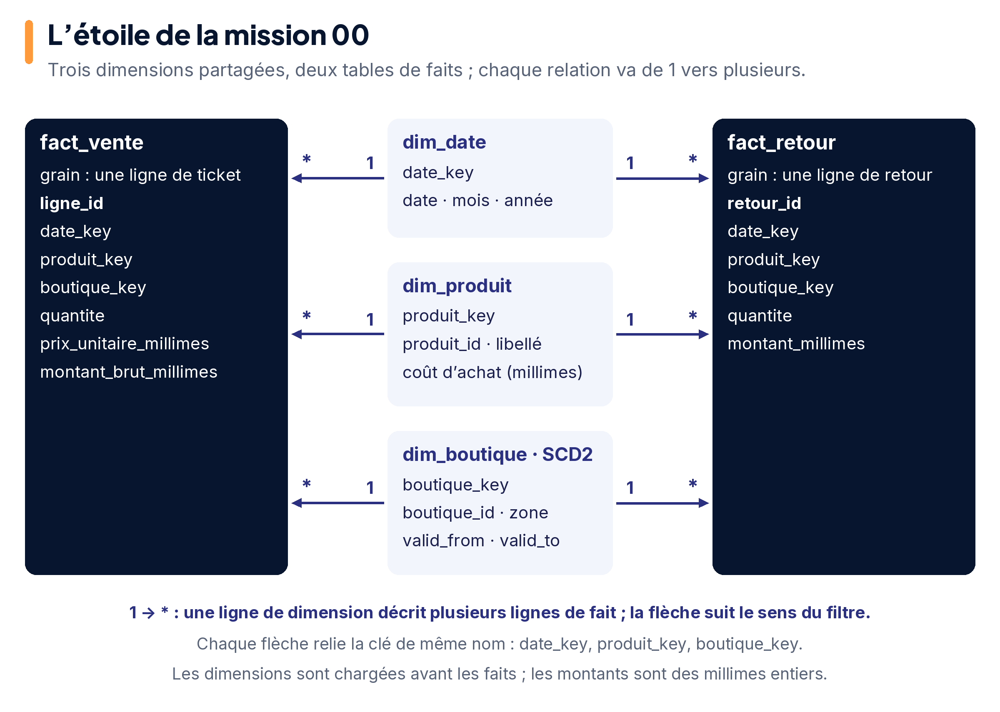

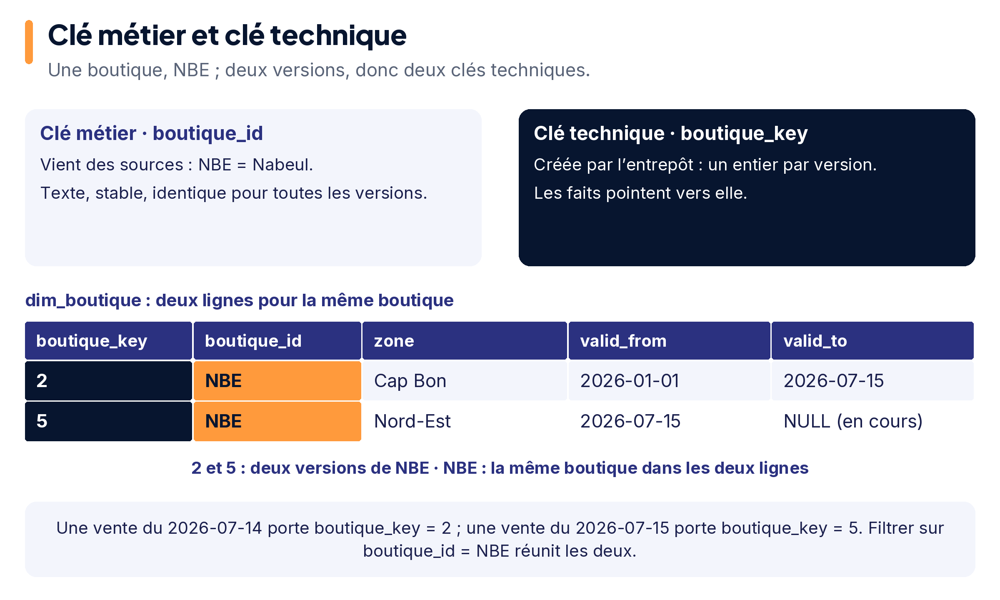

## F — Mettre à jour sans perdre le passé

Chargement initial, puis incrément, puis rejeu : le rejeu n'ajoute rien. Nabeul change de zone le 2026-07-15 ; une vente du 14 juillet garde l'ancienne version.

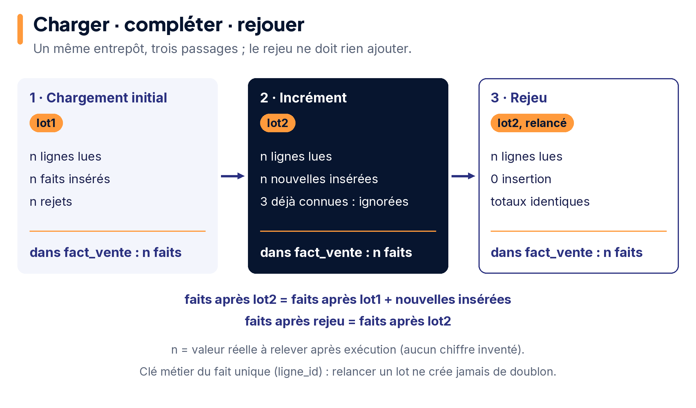

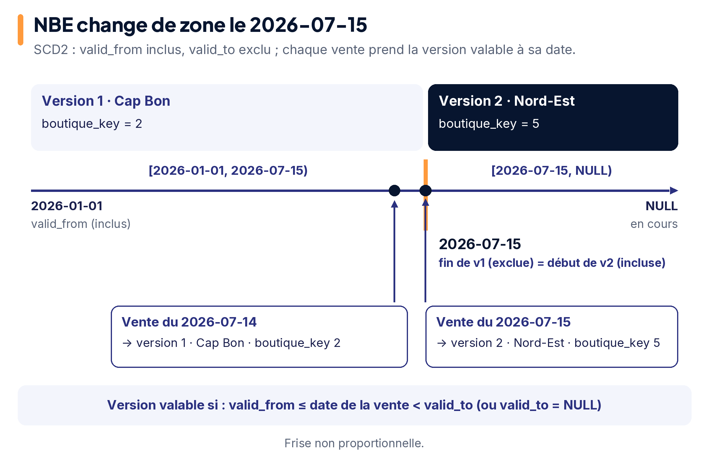

## G — Livrer et prouver

Un chiffre plausible n'est pas un chiffre juste : seul un contrôle les distingue. L'application locale et Power BI montrent les mêmes indicateurs, avec leurs unités.

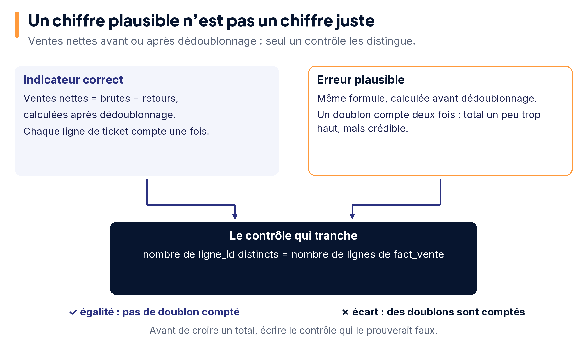

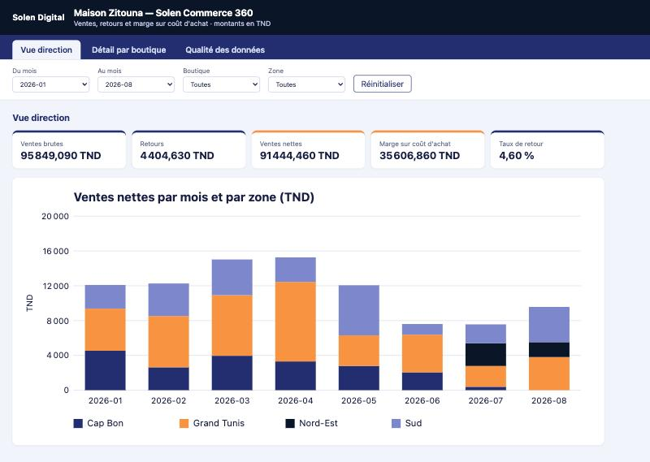

*Capture réelle de l'application de référence (navigateur intégré, macOS, 28 octobre 2026). Les valeurs affichées sont les valeurs de référence après le lot 2. Le registre de provenance des captures est dans [images/captures/REGISTRE.json](images/captures/REGISTRE.json).*

## H — Le calendrier et la soutenance

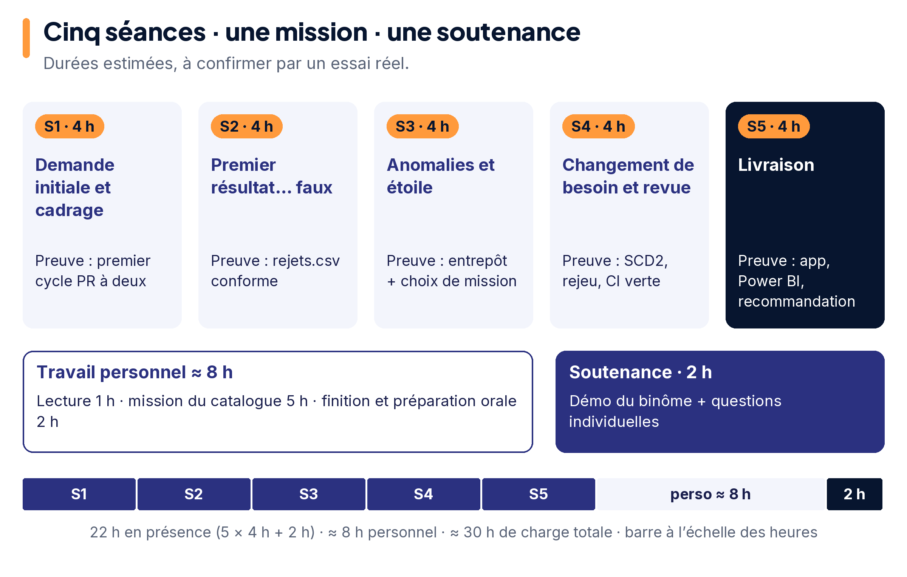

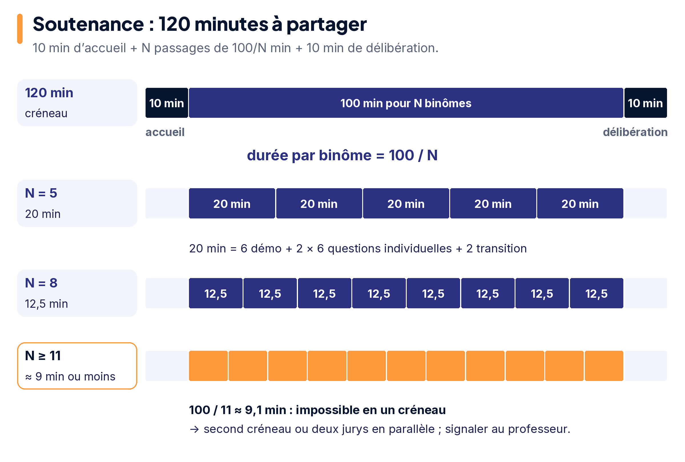

Les schémas décrivent le fonctionnement et ne prétendent pas montrer l'interface réelle de votre poste. Les sources officielles vérifiées le 28 octobre 2026 sont dans [setup/sources.json](setup/sources.json).
