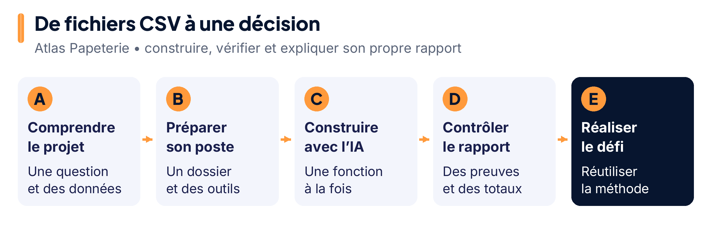
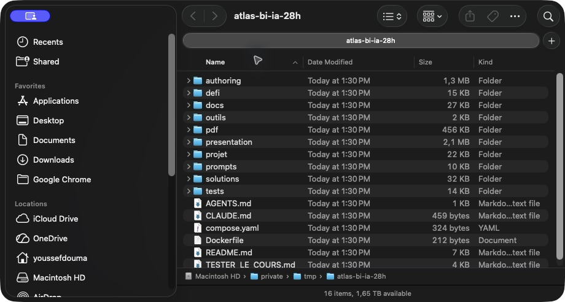
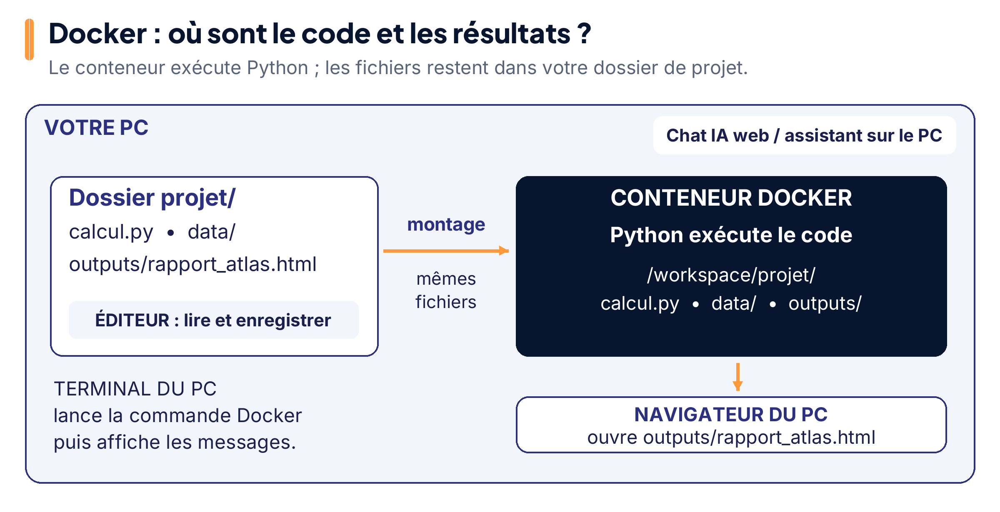
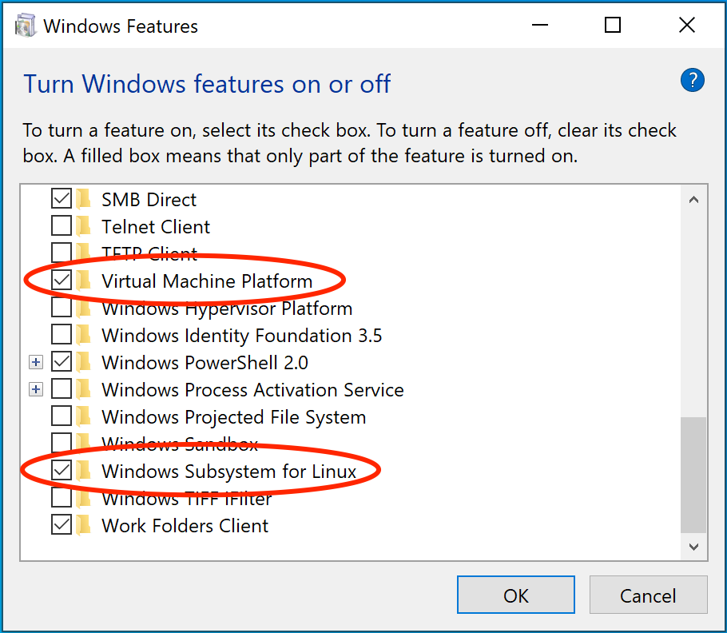
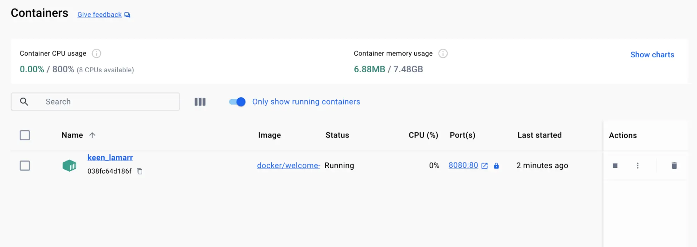
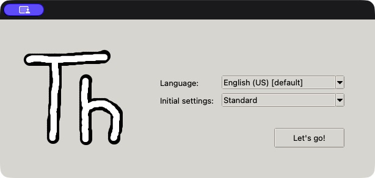
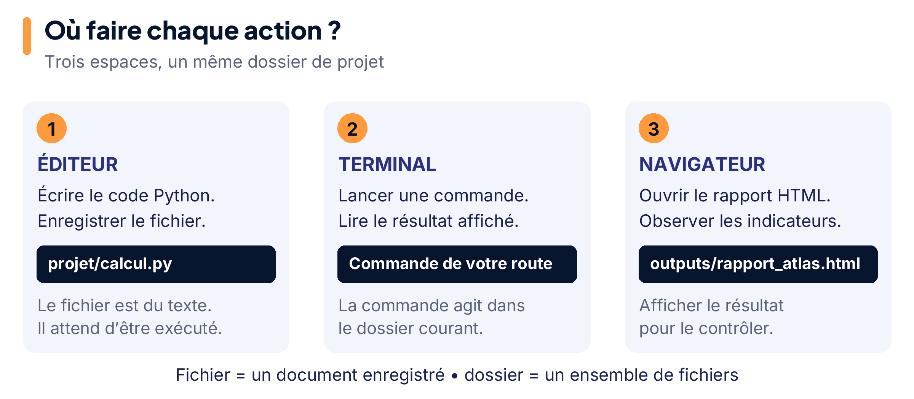
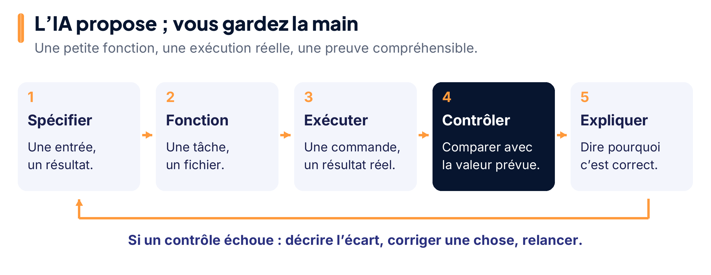
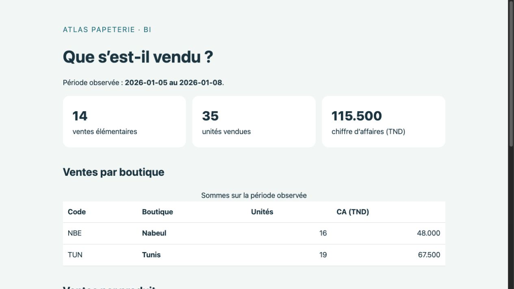
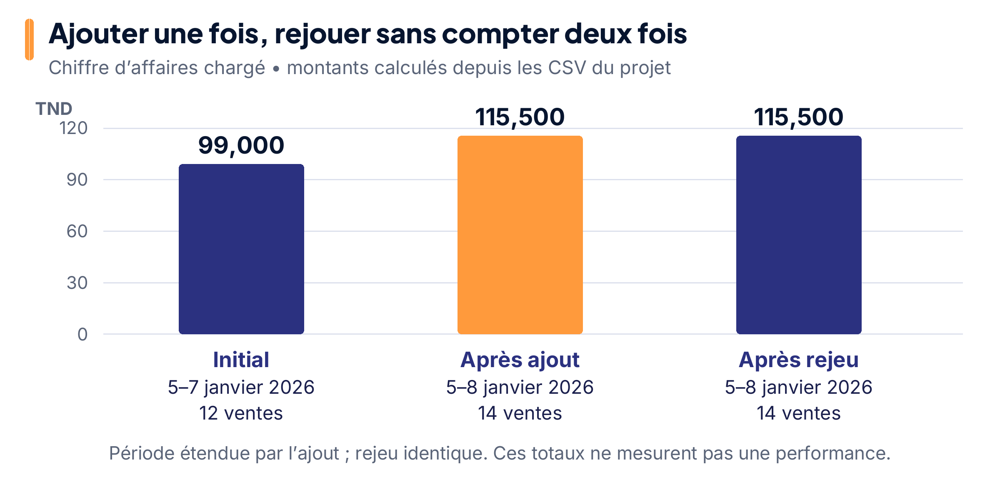

# Atlas, du premier clic au rapport

[← Retour au cours](../README.md)

**A. Comprendre → B. Préparer → C. Construire → D. Contrôler → E. Relever le défi.**

Cette page aide à reconnaître les étapes. Le [guide 01](../pdf/01_demarrer_windows_ubuntu.pdf) fournit les commandes complètes de votre système ; le [cours 02](../pdf/02_cours_atlas_ia.pdf) conduit les missions.

[A — Comprendre](#a--comprendre) · [B — Préparer](#b--préparer) · [C — Construire](#c--construire) · [D — Contrôler](#d--contrôler) · [E — Défi](#e--défi)

## A — Comprendre

Atlas Papeterie veut examiner les ventes de ses deux boutiques. Vous transformez des fichiers CSV en entrepôt SQLite, puis en rapport local. Gardez ce fil conducteur pendant toutes les missions.



*Schéma conceptuel : situer chaque étape avant de manipuler les outils.*

## B — Préparer

### 1. Télécharger et extraire

Sur le [dépôt](https://github.com/jodouma/leaders-bi-ia-etl-28h), cliquer **Code → Download ZIP**. Extraire tout, puis ouvrir le dossier contenant `README.md`, `compose.yaml` et `projet/`.


*Capture réelle du dépôt, sans compte connecté. Download ZIP signifie « télécharger l’archive ».*



*Exemple réel dans Finder sous macOS. Sous Windows utiliser l’Explorateur, sous Ubuntu le gestionnaire de fichiers. Retrouver les mêmes noms : `compose.yaml`, `pdf/` et `projet/`.*

### 2. Comprendre Docker

Docker fait tourner le Python du cours dans un conteneur. Vos fichiers restent dans le dossier du cours, partagé avec ce conteneur. Vous consultez le rapport dans le navigateur. Un conteneur n’est pas un fichier Python ni votre assistant IA.



Suivre **une seule route** du guide 01 :

| Poste | Route |
|---|---|
| Windows | Docker Desktop avec WSL 2 ; commandes dans **PowerShell Windows** |
| Ubuntu | Docker Engine et Compose ; préparer `.env`, puis utiliser **sudo docker compose** |
| Docker impossible | Repli Python natif avec Thonny, dans le même guide |

### 3. Reconnaître les repères

Dans les écrans anglais, **Enabled** signifie **Activé**. Les captures officielles ci-dessous sont historiques : Windows 11 peut présenter ces réglages autrement. Suivre les instructions actuelles du guide 01.



*Capture officielle Docker, Apache 2.0 ; repère de dépannage, pas une installation réalisée sur notre poste. [Attributions](images/setup/ATTRIBUTIONS.md).*



*Running signifie « en cours d’exécution ». Les noms et ports de cet exemple officiel diffèrent d’Atlas : utiliser ceux du guide.*

### 4. Repérer l’éditeur

Pour le repli natif, installer Thonny depuis le lien officiel du guide. Au premier accueil, **Language** sert au choix de langue ; **Let’s go** signifie « démarrer ».



*Accueil observé sous macOS à partir du paquet officiel ; ce n’est ni l’installateur Windows ni la preuve d’une configuration terminée.*

L’environnement est prêt lorsque ses contrôles de version et, avec Docker, le **build** réussissent. Le message **« mission à construire »** concerne ensuite une fonction incomplète, à réaliser dans le cours 02.

## C — Construire



- **Éditeur** : ouvrir et enregistrer le fichier dans `projet/`.
- **Terminal** : exécuter la commande du cours. Avec Docker, se placer à la racine contenant `compose.yaml` ; en Python natif, dans `projet/`.
- **Navigateur** : consulter le chat IA ou le rapport, selon l’étape.

Suivre le [cours 02](../pdf/02_cours_atlas_ia.pdf) et copier le [prompt de la mission](../prompts/README.md). Demander une fonction à la fois ; conserver les imports et les aides déjà fournis. Enregistrer, exécuter et contrôler avant de poursuivre.



Exemple de demande d’explication, à adapter :

```text
Je débute et je suis à la mission 01 du cours Atlas.
Explique en trois phrases quantité, prix en millimes et total.
Utilise 2 carnets à 4500 millimes comme exemple.
Ne modifie aucun fichier ; pose-moi une question de vérification.
```

Pour demander une réparation, joindre la petite fonction, la commande et le message exact. Conserver la première tentative et son contrôle. Les prompts complets du cours précisent les règles de chaque fonction.

Les fichiers `AGENTS.md` et `CLAUDE.md` guident les CLI facultatifs. Le socle utilise un chat web et les programmes locaux ; aucune installation StoryOS n’est requise.

## D — Contrôler

Après les sept missions, exécuter le programme et ses contrôles, puis ouvrir le rapport. Voici le vrai résultat servi par Docker Linux sur le poste macOS de préparation :



Attendu après ajout : **14 ventes élémentaires, 35 articles, 115.500 TND**. Le rejeu conserve ces totaux. [Voir la capture complète](images/real/rapport-atlas-complet.jpg).



Ce graphique compare des **états du même entrepôt**, dont la période passe de trois à quatre jours ; il ne mesure pas une hausse de performance. Le rejeu n’ajoute aucune vente déjà chargée.

## E — Défi

Après le projet guidé, ouvrir [04_defi_campus_box.pdf](../pdf/04_defi_campus_box.pdf). En groupe de trois maximum : expliquer le besoin, construire avec de nouvelles données et règles, contrôler, présenter les preuves. Chaque membre explique sa contribution.

Pour tester la clarté du cours, utiliser la [fiche de test](../TESTER_LE_COURS.md) : étape, attendu, observé, message exact et capture. Garder les corrigés pour après un premier essai.

[Retour au cours](../README.md) · [Provenance des images](images/SOURCES.json)
