# Du premier dossier au tableau de bord

[Commencer le cours](../README.md) · [Guide d’installation PDF](../pdf/01_demarrer_windows_ubuntu.pdf)

## A — Comprendre la mission

Vous rejoignez Atlas Papeterie. Les ventes viennent de fichiers et d’une base SQL. Votre mission : produire des chiffres fiables et expliquer une décision.

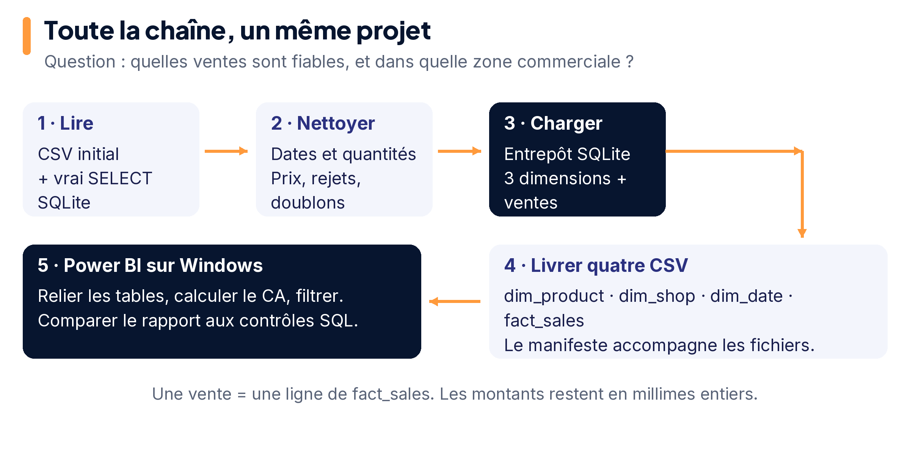

## B — Installer et choisir le bon environnement

Suivre le PDF 01 dans l’ordre. Sous Windows, installer WSL2 et Ubuntu, puis choisir l’agent WSL dans Codex. Codex reste une fenêtre Windows ; Python travaille dans Ubuntu. Power BI Desktop se lance sur Windows.

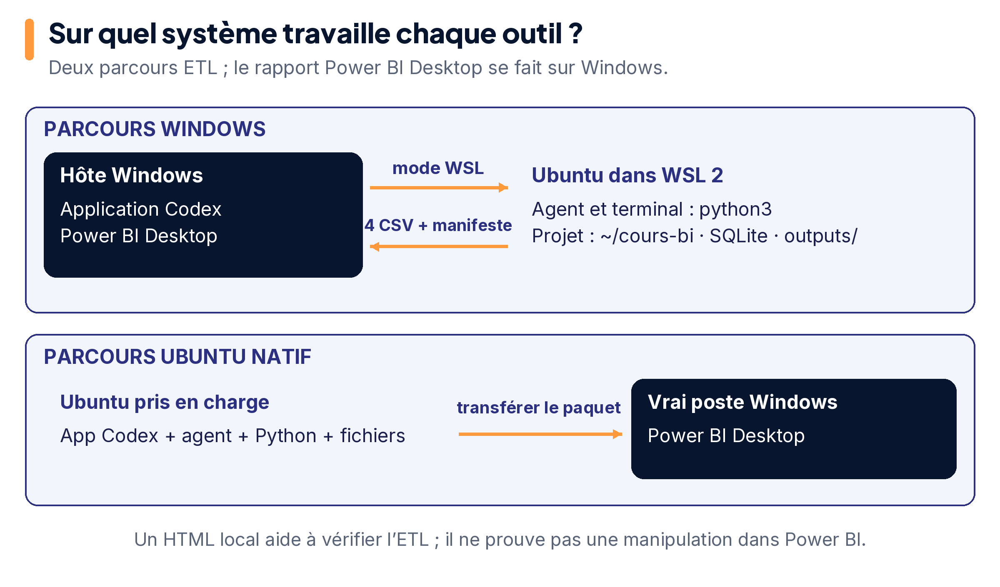

Sous Ubuntu pris en charge, utiliser Codex et Python directement. La partie Power BI Desktop se réalise sur le poste Windows d’un binôme ou de la salle.

## C — Télécharger et ouvrir le cours

Choisir **Code → Download ZIP**, extraire tout, puis suivre le PDF 01 pour placer les fichiers dans `~/cours-bi`. Ouvrir **la racine du cours** dans Codex : elle contient `README.md`, `AGENTS.md`, `projet/` et `outils/`.

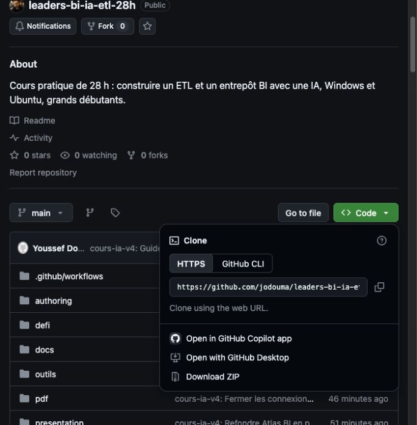

*Capture réelle du menu GitHub ; elle illustre le téléchargement, sans prouver une installation Windows ou Ubuntu.*

Le guide fait créer `atelier/` une seule fois. Conserver ce dossier d’une séance à l’autre. Les fichiers à modifier sont dans `atelier/` ; les commandes Python se lancent depuis ce dossier.

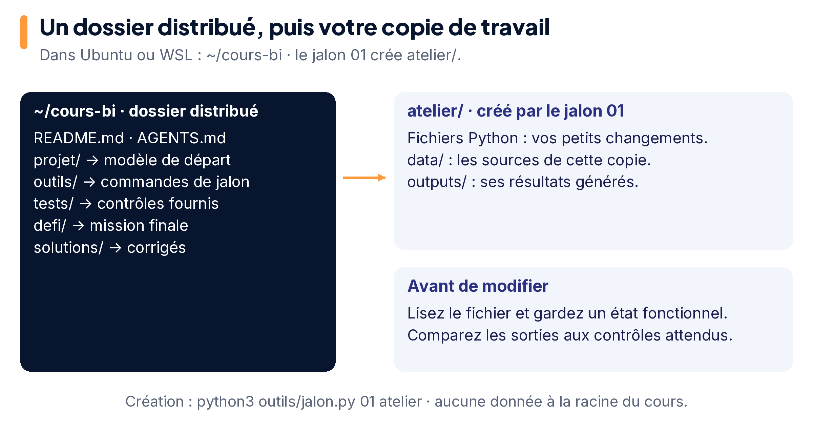

## D — Faire une petite demande, puis vérifier

Ouvrir les [prompts du cours](../prompts/README.md). Donner un objectif, les fichiers utiles, une limite et une preuve attendue. Exemple :

```text
Dans atelier/nettoyage.py, complète seulement normaliser_vente.
Utilise les helpers fournis et garde les montants en millimes entiers.
Refuse les identifiants absents ou non textuels.
Lance le contrôle 02 depuis atelier, puis explique le résultat.
Ne modifie ni les sources ni le vérificateur.
```

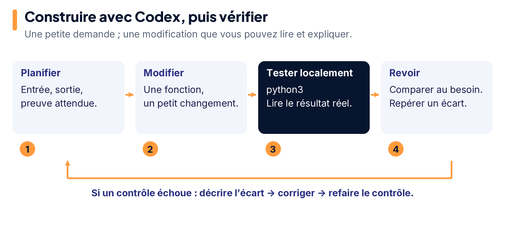

Choisir Luna et High si proposés. Standard désigne la vitesse. Vérifier l’usage réellement affiché, puis travailler localement entre les demandes.

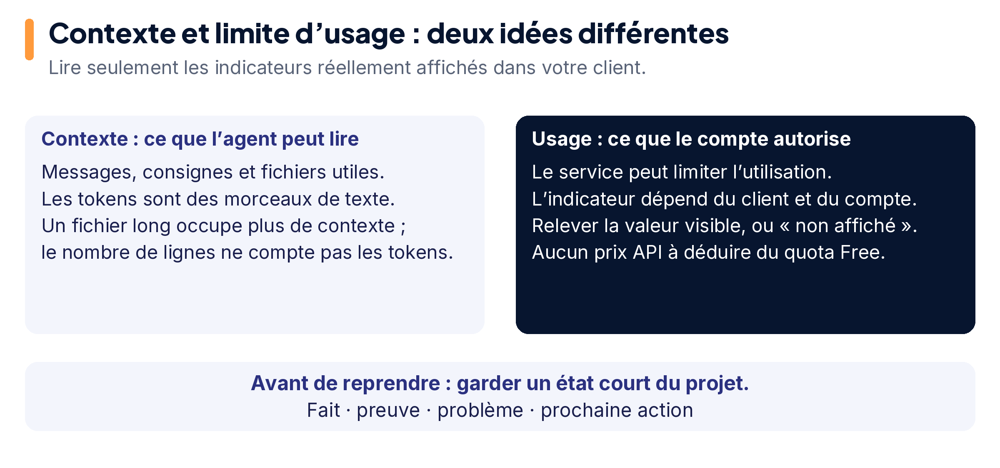

## E — Garder le passé juste

Une vente est un fait ; le produit, la boutique et la date la décrivent. Le 8 janvier, Nabeul change de zone commerciale. Les anciennes ventes gardent leur ancienne version de boutique.

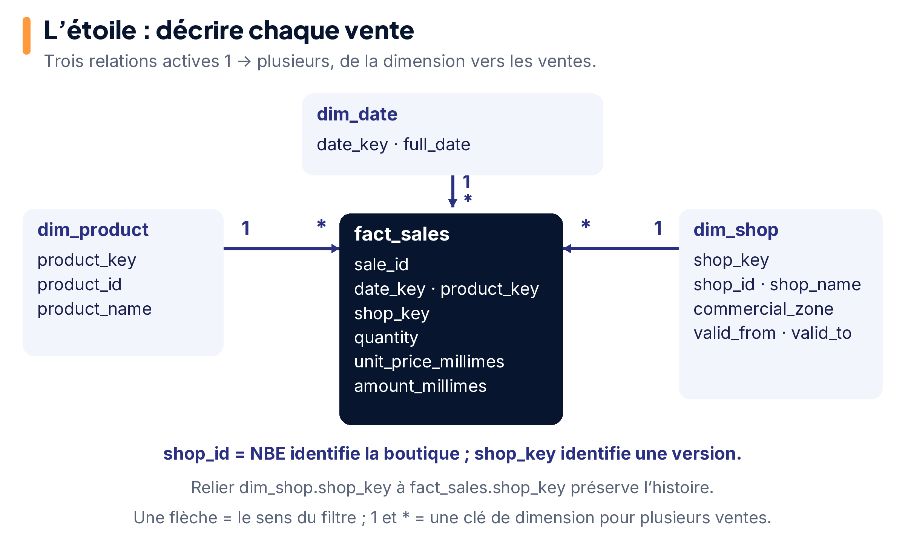

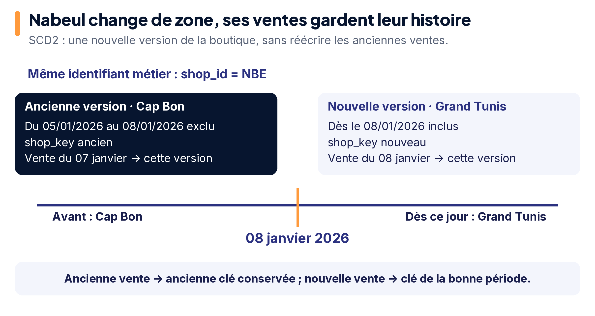

## F — Livrer et faire relire

Exporter les quatre CSV, puis suivre le [guide Power BI](../powerbi/README.md) : types, relations, mesure, visuels et actualisation. Le rapport HTML local aide à contrôler l’ETL ; le tableau de bord Power BI reste une étape distincte.

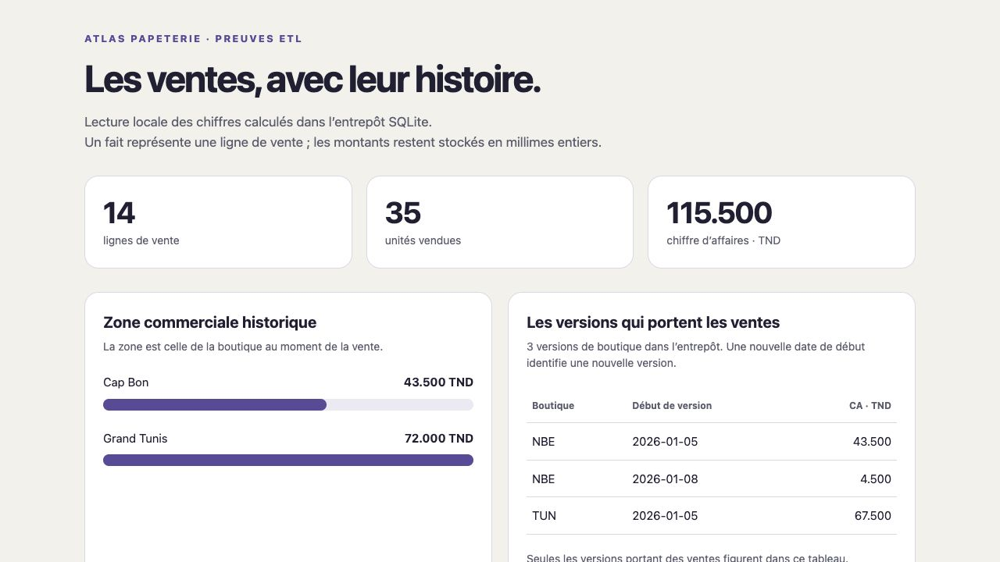

*Rapport réellement produit et observé sur le poste auteur macOS. Cette capture prouve la vue HTML et les valeurs affichées ; la manipulation Power BI Desktop reste distincte.*

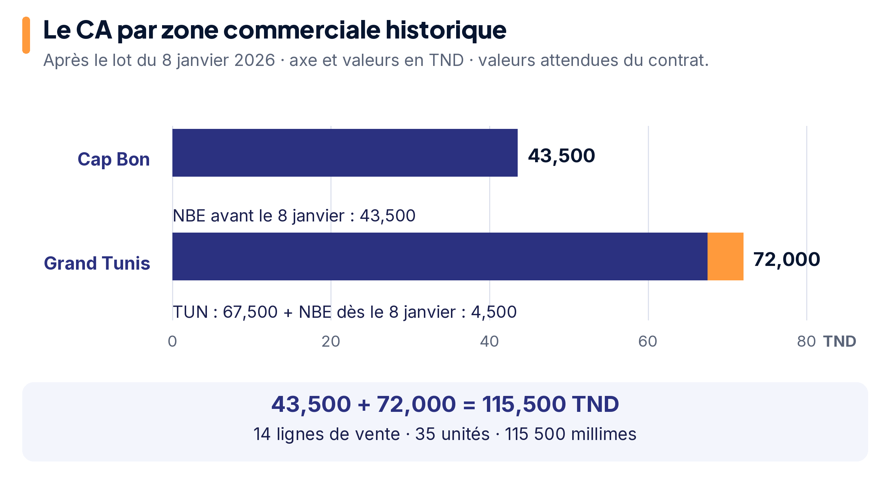

Comparer les résultats aux contrôles, demander une revue en lecture seule, corriger, puis vérifier à nouveau. Deux lecteurs peuvent examiner des points différents si les sous-agents sont disponibles ; un seul auteur modifie les fichiers.

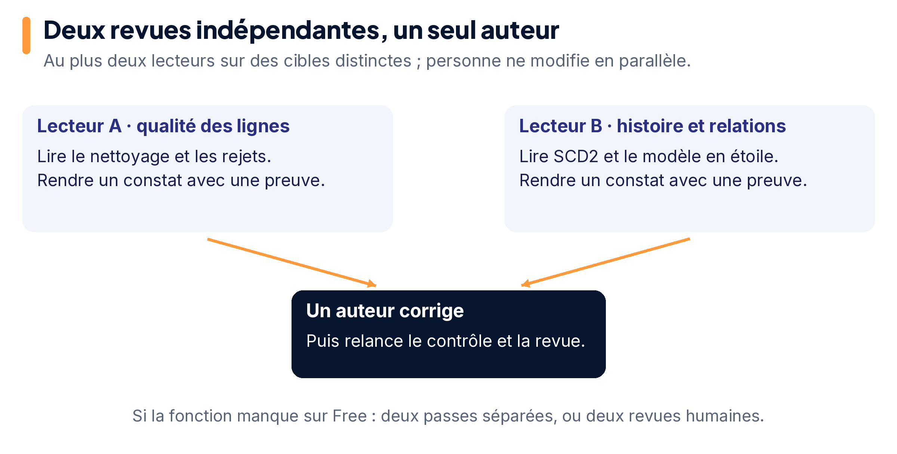

Les schémas sont des explications conceptuelles. Les captures sont identifiées comme telles ; les [sources et limites des images](images/README.md) distinguent illustration et manipulation réelle.
